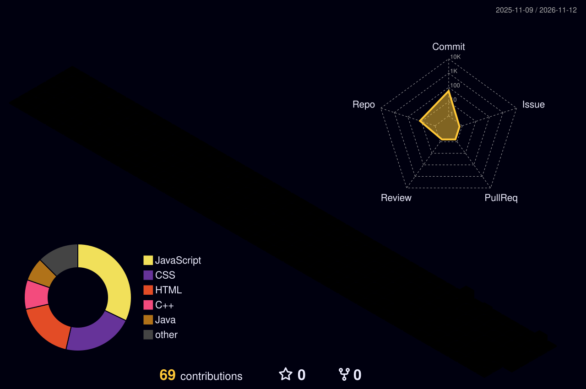

  

  

  
  

## About Me

I build full-stack web applications and IoT systems that connect hardware with AI.
I enjoy taking an idea from a sensor reading or a rough sketch all the way to a working product.

- 🔭 Currently improving **Aegis Care**, an AI-assisted fall detection wearable
- 🌱 Strengthening problem solving with **Data Structures & Algorithms in C++**
- 🤝 Open to internships, collaborations and interesting projects

## Featured Projects

<table>
  <tr>
    <td width="50%" valign="top">
      <h3><a href="https://github.com/devsedoc/aegis-care-fall-detection">Aegis Care</a></h3>
      
An AI-powered fall detection system. A wearable built on an ESP8266 and MPU6050 detects falls in real time, an Android companion app sends the alert, and a Gemini-based assistant adds a conversational layer on top.

      

        
        
        
        
        
        
      

    </td>
    <td width="50%" valign="top">
      <h3><a href="https://github.com/devsedoc/studynotion-edtech">StudyNotion</a></h3>
      
A full-stack EdTech platform where instructors publish courses and students browse, enroll and learn, with authentication and role-based dashboards.

      

        
        
        
        
        
      

    </td>
  </tr>
</table>

## Tech Stack

<table align="center">
  <tr>
    <td><b>Languages</b></td>
    <td>
       
      C++ · Java · JavaScript
    </td>
  </tr>
  <tr>
    <td><b>Frontend</b></td>
    <td>
       
      HTML5 · CSS3 · Tailwind CSS · React
    </td>
  </tr>
  <tr>
    <td><b>Backend & Database</b></td>
    <td>
       
      Node.js · Express.js · MongoDB
    </td>
  </tr>
  <tr>
    <td><b>IoT & Mobile</b></td>
    <td>
       
      Arduino / ESP8266 · Android Studio
    </td>
  </tr>
  <tr>
    <td><b>Tools</b></td>
    <td>
       
      Git · GitHub · VS Code · Postman
    </td>
  </tr>
</table>

## GitHub Activity

  

  
  

  

  <picture>
    <source media="(prefers-color-scheme: dark)" srcset="https://raw.githubusercontent.com/devsedoc/devsedoc/output/snake-dark.svg" />
    
  </picture>

  

